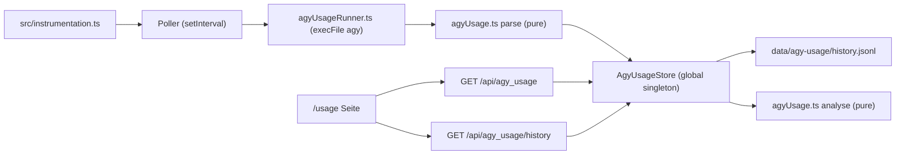

# Plan: Antigravity-Usage-Limits (5h / weekly) in die App einbinden und auswerten

> Übergabe-Dokument für den implementierenden Agent. Lies vorher `CLAUDE.md` (Architektur, Konventionen, Testaufbau).

## 1. Ziel

Die App soll die Antigravity-(`agy`)-Kontingente des eingeloggten Google-Accounts regelmäßig abfragen, als Verlauf speichern und auf einer eigenen Seite anzeigen und auswerten: Live-Stand, Verbrauchstempo, Prognose, Engpass-Erkennung.

## 2. Verifizierte Datenquelle (bereits recherchiert, nicht erneut erforschen)

Die offizielle CLI liefert die Werte als JSON über ihren Print-Mode:

```bash
agy -p /usage --output-format json
```

Fakten, am 2026-11-05 unter Windows geprüft:

- `/usage` ist ein **lokaler Slash-Command**. Es läuft kein Modell-Turn (`num_turns: 0`, `total_tokens: 0`), es wird also **kein Kontingent verbraucht**. `conversation_id` ist leer, es entsteht keine Conversation.
- Exit-Code 0, Laufzeit **ca. 20–30 s**, weil der Language-Server bei jedem Aufruf neu startet. Deshalb nie synchron pro Seitenaufruf abfragen.
- Funktioniert parallel zu einer laufenden interaktiven `agy`-Session.
- `agy` muss für den OS-User, unter dem der Next-Server läuft, installiert und **eingeloggt** sein (Daten unter `~/.gemini/antigravity-cli/`).
- Die Struktur steht in `command.data` und wird generisch gelesen: `groups[] -> buckets[]`. Gruppen und Buckets **nicht hardcoden**. Es gibt Gruppen mit nur einem Bucket, z. B. „Gemini 4 Argon“ hat nur ein Weekly-Limit.
- `response` enthält dieselben Daten zusätzlich als TSV. **Nicht** verwenden, nur `command.data` parsen.

### Echte Beispielausgabe (als Test-Fixture verwenden)

Speichern als `tests/fixtures/agy-usage.json`:

```json
{"conversation_id":"","status":"SUCCESS","response":"Gemini Models\tWeekly Limit Remaining\t99%\t2026-11-11T22:33:15Z\nGemini Models\tFive Hour Limit Remaining\t100%\t2026-11-05T22:25:43Z\nClaude and GPT models\tWeekly Limit Remaining\t89%\t2026-11-12T17:23:39Z\nClaude and GPT models\tFive Hour Limit Remaining\t77%\t2026-11-05T22:23:39Z\nGemini 4 Argon\tGemini 4 Argon Weekly Limit\t59%\t2026-11-11T22:18:50Z\n","duration_seconds":0,"num_turns":0,"usage":{"input_tokens":0,"output_tokens":0,"thinking_tokens":0,"cache_read_tokens":0,"total_tokens":0},"command":{"name":"usage","data":{"description":"Within each group, models share a weekly limit and a 5-hour limit. Quota is consumed proportionally to the cost of the tokens. Thus, limits will last longer with shorter tasks or using more cost-effective models. The 5-hour limit smooths out aggregate demand to fairly distribute global capacity across all users, while your weekly limit is tied directly to your individual tier.","groups":[{"name":"Gemini Models","description":"Models within this group: Gemini Flash, Gemini Pro","buckets":[{"id":"gemini-weekly","name":"Weekly Limit Remaining","description":"You have used some of your weekly limit, it will fully refresh in 6 days, 5 hours.","window":"weekly","remaining_fraction":0.9877457022666931,"reset_time":"2026-11-11T22:33:15Z"},{"id":"gemini-5h","name":"Five Hour Limit Remaining","description":"You have used some of your 5-hour limit, it will fully refresh in 4 hours, 59 minutes.","window":"5h","remaining_fraction":0.9993330240249634,"reset_time":"2026-11-05T22:25:43Z"}]},{"name":"Claude and GPT models","description":"Models within this group: Claude Opus, Claude Sonnet, GPT-OSS","buckets":[{"id":"3p-weekly","name":"Weekly Limit Remaining","description":"You have used some of your weekly limit, it will fully refresh in 6 days, 23 hours.","window":"weekly","remaining_fraction":0.8858795762062073,"reset_time":"2026-11-12T17:23:39Z"},{"id":"3p-5h","name":"Five Hour Limit Remaining","description":"You have used some of your 5-hour limit, it will fully refresh in 4 hours, 57 minutes.","window":"5h","remaining_fraction":0.7717592120170593,"reset_time":"2026-11-05T22:23:39Z"}]},{"name":"Gemini 4 Argon","description":"For paid Pro plans, Argon quota is separate. Higher Argon quota (included as part of the larger Gemini quota bucket) is available on Ultra plans.","buckets":[{"id":"gemini-argon-wtu-weekly","name":"Gemini 4 Argon Weekly Limit","description":"You have used some of your weekly limit, it will fully refresh in 6 days, 4 hours.","window":"weekly","remaining_fraction":0.5851913094520569,"reset_time":"2026-11-11T22:18:50Z"}]}]}}}
```

### Bekannte Eigenheiten der Daten

1. **`reset_time` bei vollem Bucket ist bedeutungslos.** Bei `remaining_fraction ≈ 1` ist `reset_time` nur „jetzt + Fensterlänge“ und verschiebt sich mit jeder Abfrage (rollierendes Fenster, z. B. `gemini-5h` oben). In der Oberfläche dann „Kontingent verfügbar“ anzeigen statt eines Countdowns. Schwelle: `remaining_fraction >= 0.9995`.
2. `window` ist bisher `"5h"` oder `"weekly"`. Unbekannte Werte trotzdem durchreichen und anzeigen. Für die Prognose die Fensterlänge nur bei bekannten Werten verwenden: `5h` = 5 h, `weekly` = 7 d.
3. Das JSON-Format ist nicht offiziell dokumentiert und kann sich mit `agy`-Updates ändern. Deshalb **defensiv parsen**: fehlende optionale Felder tolerieren, unbekannte ignorieren, Buckets ohne `id` oder ohne numerisches `remaining_fraction` verwerfen und loggen statt den ganzen Snapshot zu verwerfen.

## 3. Architektur



Wegen der Testbarkeit (siehe `CLAUDE.md` → Tests) gehört alle Logik, die Unit-Tests braucht, in **ein abhängigkeitsfreies Modul** `src/lib/agyUsage.ts`. Erlaubt sind dort nur Typen und reine Funktionen: kein `@/`-Import, kein `fs`, kein `child_process`, kein `pino`.

## 4. Umsetzungsschritte

### Schritt 1 – `src/lib/agyUsage.ts` (pur, testbar)

Typen:

```ts
export type AgyWindow = '5h' | 'weekly' | string;

export interface AgyBucket {
  id: string;              // z. B. "3p-5h"
  name: string;
  description?: string;
  window: AgyWindow;
  remainingFraction: number; // 0..1, auf [0,1] geklemmt
  resetTime: string | null;  // ISO; null wenn fehlend/ungültig
}

export interface AgyGroup { name: string; description?: string; buckets: AgyBucket[]; }

export interface AgyUsageSnapshot {
  fetchedAt: string;        // ISO, vom Aufrufer gesetzt
  description?: string;
  groups: AgyGroup[];
}

export type AgyErrorCode =
  | 'AGY_DISABLED' | 'AGY_NOT_FOUND' | 'AGY_TIMEOUT'
  | 'AGY_FAILED' | 'AGY_PARSE_ERROR';
```

Funktionen:

- `parseAgyUsageOutput(stdout: string, fetchedAt: string): AgyUsageSnapshot`
  - Ganzes stdout per `JSON.parse` lesen. Fallback: die **letzte** Zeile, die mit `{` beginnt, falls `agy` Log-Zeilen davor schreibt.
  - Prüfen: `status === 'SUCCESS'` und `command?.name === 'usage'` und `Array.isArray(command.data.groups)`. Sonst einen Fehler mit Code `AGY_PARSE_ERROR` bzw. `AGY_FAILED` werfen (eigene kleine Error-Klasse `AgyUsageError { code, message }` im selben Modul).
  - Feldnamen von snake_case auf camelCase mappen.
- `isBucketFull(b)` → `remainingFraction >= 0.9995`.
- `effectiveResetTime(b)` → `null`, wenn voll, sonst `resetTime`.
- `bucketKey(groupName, bucketId)` → stabiler Schlüssel für den Verlauf (`bucketId` reicht, solange eindeutig; sonst mit Gruppe kombinieren).
- **Analyse** über eine Liste von Verlaufspunkten `{ t: number /*epoch ms*/, r: number }` eines Buckets (siehe Schritt 5):
  - `detectResets(points)`: ein Reset liegt vor, wenn `r` gegenüber dem Vorpunkt um mehr als `0.02` **steigt**.
  - `currentWindowPoints(points)`: Punkte seit dem letzten Reset.
  - `burnRatePerHour(points)`: Verbrauch pro Stunde im aktuellen Fenster, `(r_first - r_last) / Δh`. `null` bei weniger als 2 Punkten oder Δh < 10 min.
  - `projectExhaustion(bucket, rate, now)`: Zeitpunkt, an dem `r` auf 0 fällt (`now + r / rate`). Liefert `{ exhaustsAt, beforeReset: boolean }`. `beforeReset = exhaustsAt < effectiveResetTime`. Bei `rate <= 0` → `null`.
  - `dailyConsumption(points, tzOffsetMinutes)`: Summe aller Abnahmen (Zunahmen ignorieren) pro Kalendertag.
  - `exhaustionEvents(points)`: Zeiträume mit `r <= 0.01`. Daran sieht man, wann das 5h-Limit tatsächlich der Engpass war. Ausgabe: Start, Ende, Dauer.

### Schritt 2 – `src/lib/agyUsageRunner.ts` (Prozessaufruf)

- `child_process.execFile(bin, ['-p', '/usage', '--output-format', 'json'], { timeout, maxBuffer: 1_000_000, windowsHide: true })`.
  - Feste Argumente. **Niemals** Request-Parameter oder Benutzereingaben in den Aufruf übernehmen, kein `shell: true`.
  - `bin = process.env.AGY_BIN || 'agy'`. Unter systemd ist `PATH` oft unvollständig, daher die Override-Variable.
  - `timeout = Number(process.env.AGY_USAGE_TIMEOUT_MS) || 90_000`.
- **Single-Flight:** Läuft schon ein Aufruf, bekommen weitere Aufrufer dasselbe Promise.
- Fehler auf `AgyErrorCode` abbilden:
  - `ENOENT` → `AGY_NOT_FOUND`
  - Timeout (`killed`/`signal`) → `AGY_TIMEOUT`
  - Exit ≠ 0 → `AGY_FAILED` mit Exit-Code und **erster Zeile** von stderr, auf 300 Zeichen gekürzt. Nicht ganz stderr in die API geben.
  - Parse-Fehler → `AGY_PARSE_ERROR`
- Mit `pino` nur die Zusammenfassung loggen (Dauer, Anzahl Buckets, Fehlercode), nicht das komplette stdout oder stderr.

### Schritt 3 – `src/lib/AgyUsageStore.ts` (global singleton und Poller)

Stil wie `HistoryStore.ts` und `Scheduler.ts`: `global`-Singleton, damit Hot-Reload keine doppelten Instanzen und Intervalle erzeugt.

- Zustand im Speicher: `latest: AgyUsageSnapshot | null`, `lastError: { code, message, at } | null`, `lastAttemptAt`, `inFlight`.
- `refresh(): Promise<void>` ruft den Runner auf. Bei Erfolg `latest` setzen und einen Verlaufspunkt anhängen, bei Fehler `lastError` setzen. Ein alter `latest` bleibt dann erhalten und wird als `stale` markiert.
- `start()` startet den Poller:
  - Intervall `AGY_USAGE_POLL_MINUTES` (Default **15**). Bei `0` ist alles deaktiviert, die API liefert dann `AGY_DISABLED`.
  - Erste Abfrage etwa 30 s nach dem Start, damit der Serverstart nicht gebremst wird.
  - `timer.unref()`, Guard gegen mehrfaches `start()`.
- Verlauf:
  - Datei `data/agy-usage/history.jsonl`, Verzeichnis per `AGY_USAGE_DIR` überschreibbar. `/data/` ist bereits gitignored.
  - Eine Zeile pro **erfolgreicher** Abfrage, kompakt: `{"t":"<ISO>","b":{"gemini-weekly":[0.9877,"2026-11-11T22:33:15Z"], ...},"g":{"gemini-weekly":"Gemini Models", ...}}`. Bucket-Metadaten (Namen, Beschreibungen) stehen nur im `latest`-Snapshot.
  - Anhängen mit `fs.appendFile`. Beim Start einlesen, kaputte Zeilen überspringen.
  - Aufbewahrung: `AGY_USAGE_RETENTION_DAYS` (Default **90**). Beim Start und einmal täglich ältere Punkte verwerfen und die Datei atomar neu schreiben (Temp-Datei + rename, wie `HistoryStore`).
  - Größenordnung: 96 Punkte am Tag × ca. 400 B ≈ 40 KB am Tag, unkritisch.
- `getHistory({ days, bucketId? })` liefert die Punkte, gruppiert nach Bucket als `{ t, r }[]`.
- `getStats(now)` wendet die Analysefunktionen aus Schritt 1 pro Bucket an.

### Schritt 4 – Poller beim Serverstart starten

Next 14.1 braucht dafür den Instrumentation-Hook:

- `next.config.mjs`: `experimental.instrumentationHook: true` ergänzen. `serverMinification: false` bleibt.
- Neue Datei `src/instrumentation.ts`:

  ```ts
  export async function register() {
    if (process.env.NEXT_RUNTIME !== 'nodejs') return;
    const { agyUsageStore } = await import('./lib/AgyUsageStore');
    agyUsageStore.start();
  }
  ```

- Prüfen, dass `npm run build` keinen Abfrage-Lauf auslöst. `register` läuft nur beim Serverstart.

### Schritt 5 – API-Routen

Konventionen wie bei den bestehenden Routen: `dynamic = "force-dynamic"`, `corsHeaders`, `OPTIONS`-Handler.

**`GET /api/agy_usage`** (`src/app/api/agy_usage/route.ts`)

```json
{
  "enabled": true,
  "fetchedAt": "2026-11-05T17:25:43Z",
  "stale": false,
  "pollMinutes": 15,
  "error": null,
  "snapshot": { "description": "...", "groups": [ { "name": "...", "description": "...", "buckets": [ { "id": "3p-5h", "name": "...", "window": "5h", "remainingFraction": 0.77, "resetTime": "...", "effectiveResetTime": "...", "full": false, "stats": { "burnRatePerHour": 0.04, "exhaustsAt": "...", "exhaustsBeforeReset": false } } ] } ] }
}
```

- `stale = true`, wenn `fetchedAt` älter als 2 × Poll-Intervall ist oder der letzte Versuch fehlschlug.
- `?refresh=1` stößt einen sofortigen `refresh()` an und wartet darauf (`maxDuration = 120`). Serverseitig gedrosselt: höchstens ein erzwungener Refresh pro 60 s, sonst den aktuellen Stand zurückgeben.
- Fehlerfälle liefern HTTP 200 mit `error: { code, message }`, damit die Oberfläche einen Status anzeigen kann. Nur unerwartete Exceptions geben 500 zurück.

**`GET /api/agy_usage/history?days=7&bucket=<id>`** (`src/app/api/agy_usage/history/route.ts`)

- `days` 1–90, Default 7.
- Antwort `{ buckets: { [id]: { group, name, window, points: [{ t, r }] , dailyConsumption: [{ day, used }], exhaustionEvents: [...] } } }`.

### Schritt 6 – Oberfläche: Seite `/usage`

- Neue Seite `src/app/usage/page.tsx` (`"use client"`, Stil wie `history/page.tsx`).
- Navigationseintrag in `Header.tsx` (`t.nav.usage`), zwischen „History“ und „API Docs“.
- Inhalt:
  1. Kopfzeile mit „Stand: vor X min“, Stale-Hinweis und Button „Jetzt aktualisieren“ (ruft `?refresh=1` auf, zeigt währenddessen einen Spinner, weil das 20–30 s dauert).
  2. Pro Gruppe eine Karte mit Name und Modell-Beschreibung, darin pro Bucket:
     - Fortschrittsbalken mit Prozent. Farben: ≥ 50 % grün, ≥ 20 % gelb, darunter rot.
     - „Kontingent verfügbar“, wenn voll, sonst „Reset in 4 h 57 min“ (lokale Zeit im Tooltip).
     - Verbrauchstempo pro Stunde und Prognose „reicht bis …“. Läuft der Bucket vor dem Reset leer, eine **Warnung** anzeigen.
  3. Verlauf: pro Bucket eine kleine **Inline-SVG-Sparkline** der letzten 7 Tage. Keine neue Chart-Dependency. Umschaltbar 1 / 7 / 30 Tage.
  4. Weekly-Buckets: Tagesverbrauch als einfache Balken.
  5. 5h-Buckets: Liste bzw. Anzahl der Engpass-Ereignisse der letzten 7 Tage.
  6. Fehlerzustände mit klarer Handlungsanweisung:
     - `AGY_NOT_FOUND`: „agy nicht gefunden – installieren oder `AGY_BIN` setzen“
     - `AGY_FAILED`: „agy-Login prüfen: einmal `agy` im Terminal starten“
     - `AGY_DISABLED`: „deaktiviert via `AGY_USAGE_POLL_MINUTES=0`“
- Die Oberfläche fragt `/api/agy_usage` alle 60 s neu ab. Das ist billig, weil nur der Cache gelesen wird.
- i18n: alle neuen Texte in `src/i18n/messages/de.ts` **und** `en.ts`.

### Schritt 7 – Konfiguration und Doku

- `.env.example` um diese Variablen mit Kommentaren ergänzen: `AGY_BIN`, `AGY_USAGE_POLL_MINUTES`, `AGY_USAGE_TIMEOUT_MS`, `AGY_USAGE_DIR`, `AGY_USAGE_RETENTION_DAYS`.
- `CLAUDE.md`: Abschnitt „`src/lib/AgyUsageStore.ts` – Antigravity quota tracking“ unter *Architecture*, außerdem `/usage` unter *Frontend*.
- `README.md` (API Reference) und `src/app/docs/swagger-suno-api.json`: die zwei neuen Endpunkte.
- `DEPLOY.md` (deutsch), kurzer Abschnitt „Antigravity-Usage“: `agy` auf dem Server-Host installieren und unter demselben OS-User einmal interaktiv einloggen. Unter systemd ggf. `AGY_BIN` mit absolutem Pfad setzen.

### Schritt 8 (optional, zuletzt) – `/credits`

Im `agy`-Binary gibt es auch einen JSON-Report für `/credits`. Einmal `agy -p /credits --output-format json` ausführen:

- Liefert er sinnvolle Daten mit `num_turns: 0` und `total_tokens: 0`, nach demselben Muster (Parser, Speicher, Feld `credits` in `/api/agy_usage`, kleine Karte in der Oberfläche) mitnehmen.
- Sonst weglassen und im Abschlussbericht erwähnen.

Pro Poll-Zyklus nicht mehr als zwei `agy`-Aufrufe, und zwar nacheinander, nicht parallel.

## 5. Tests

`tests/agyUsage.test.cjs` mit dem bestehenden Loader-Muster (`typescript.transpileModule`, siehe `tests/sunoAuthError.test.cjs`). Testfälle:

- Das Fixture ergibt 3 Gruppen und 5 Buckets. `3p-5h.remainingFraction ≈ 0.7718`. Die Argon-Gruppe hat genau einen Bucket.
- stdout mit vorangestellten Log-Zeilen wird trotzdem geparst.
- `status !== 'SUCCESS'` und falscher `command.name` erzeugen einen `AgyUsageError` mit passendem Code.
- Ein Bucket ohne `remaining_fraction` wird verworfen, der Rest bleibt erhalten.
- `isBucketFull` und `effectiveResetTime` liefern `null` für einen vollen Bucket.
- `detectResets`, `burnRatePerHour`, `projectExhaustion` (inklusive `beforeReset`), `dailyConsumption` und `exhaustionEvents` mit synthetischen Punktreihen.

Ausführen: `node --test tests/*.test.cjs`. Die bestehenden Tests müssen grün bleiben. Zusätzlich muss `npm run lint` sauber durchlaufen.

## 6. Manuelle Verifikation

1. `npm run dev` mit `AGY_USAGE_POLL_MINUTES=1`. Nach ca. 30–60 s liefert `GET /api/agy_usage` einen Snapshot, und `data/agy-usage/history.jsonl` hat eine neue Zeile.
2. `GET /api/agy_usage?refresh=1` aktualisiert. Ein zweiter Aufruf innerhalb von 60 s startet keinen neuen `agy`-Prozess (Log prüfen).
3. `AGY_BIN=does-not-exist` → `error.code = AGY_NOT_FOUND`, die Seite zeigt den Hinweis.
4. `AGY_USAGE_POLL_MINUTES=0` → `AGY_DISABLED`, es wird kein Prozess gestartet.
5. Mehrere Hot-Reloads in `dev` erzeugen keine doppelten Poller (Log: höchstens ein Lauf pro Intervall).
6. Die Seite `/usage` zeigt alle Gruppen und Buckets wie in `agy` → `/usage` (TUI). Die Werte stimmen gerundet überein.

## 7. Nicht-Ziele / Leitplanken

- **Keine** internen bzw. undokumentierten Endpunkte abfragen: weder den lokalen Language-Server-Port noch `cloudcode-pa`-APIs noch OAuth-Tokens aus `~/.gemini/` auslesen. Einzige Datenquelle ist die offizielle CLI-Ausgabe von `agy -p /usage`.
- Keine Änderungen an `~/.gemini/antigravity-cli/settings.json`, also auch kein Statusline-Hook.
- Keine neue Chart- oder DB-Dependency.
- Bestehende Verträge (`/api/custom_generate`, `/api/get_limit`) bleiben unverändert.

## 8. Abnahmekriterien

- [ ] `/usage` zeigt live alle `agy`-Gruppen und -Buckets mit Prozent, Reset bzw. „verfügbar“, Tempo und Prognose.
- [ ] Der Verlauf wird persistent gespeichert, übersteht Neustarts und wird nach Aufbewahrungsfrist gekürzt.
- [ ] Die Auswertung zeigt Sparkline, Tagesverbrauch (weekly) und Engpass-Ereignisse (5h).
- [ ] Alle Fehlerfälle zeigen eine verständliche Meldung, der Server stürzt nicht ab.
- [ ] Unit-Tests für Parser und Analyse sind grün, `npm run lint` ist sauber.
- [ ] Doku (`CLAUDE.md`, `README.md`, Swagger, `DEPLOY.md`, `.env.example`) ist aktualisiert.
